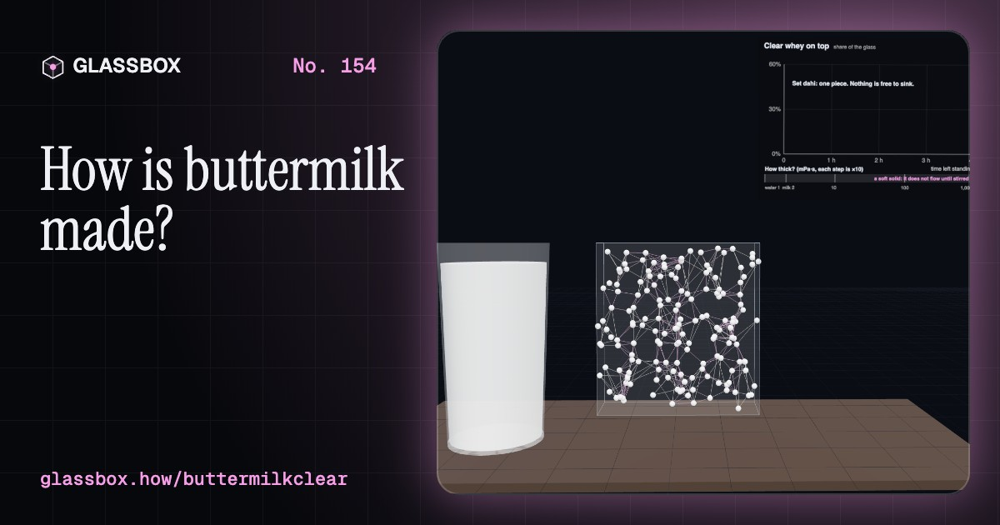
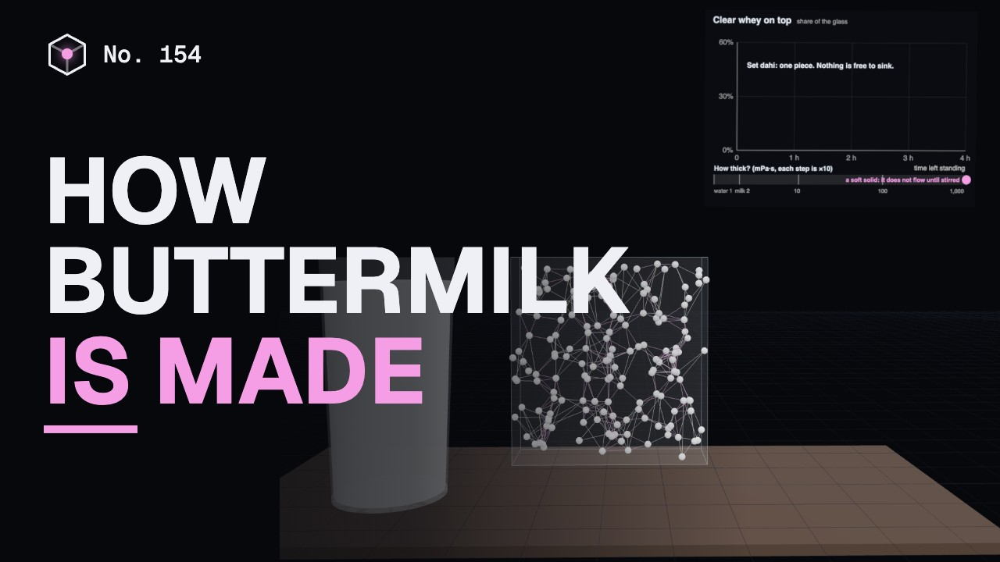
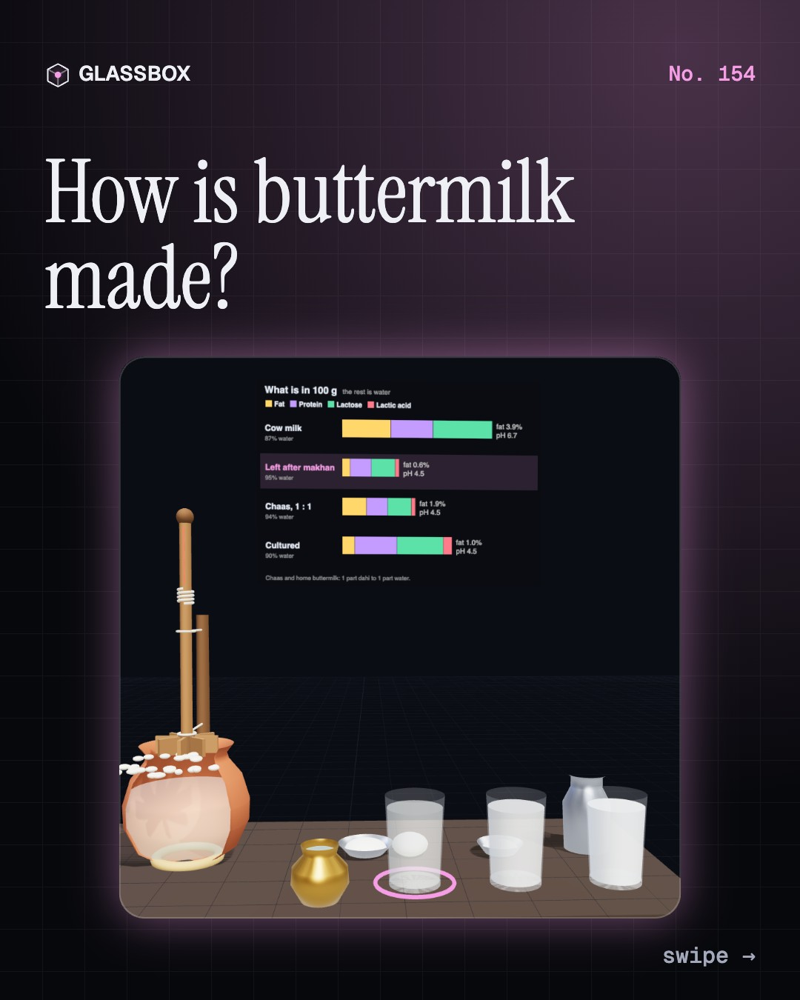
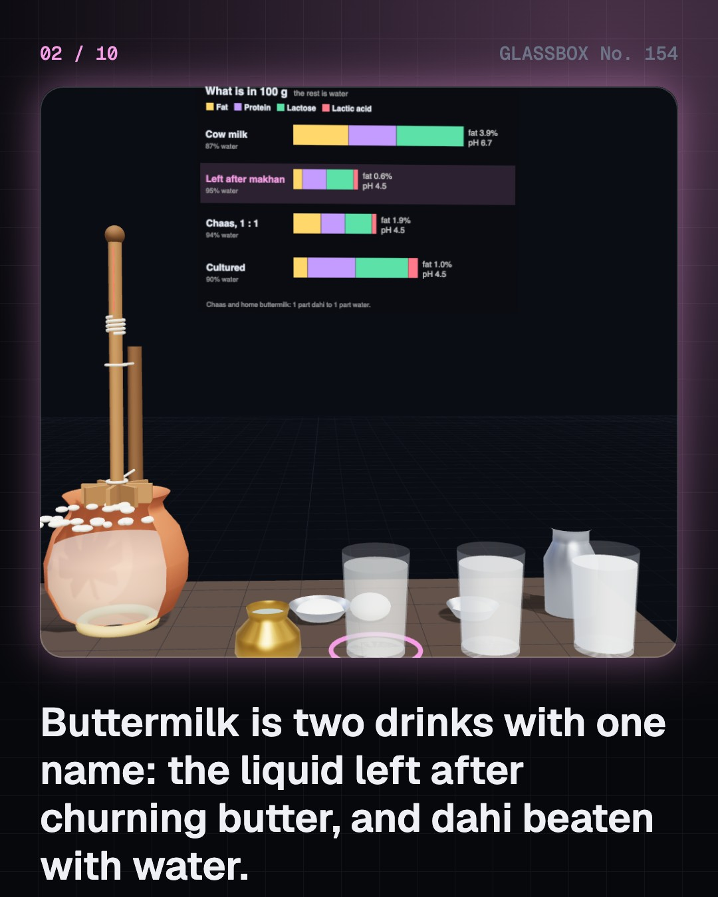
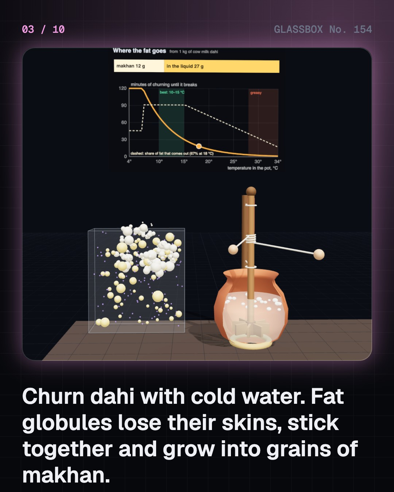
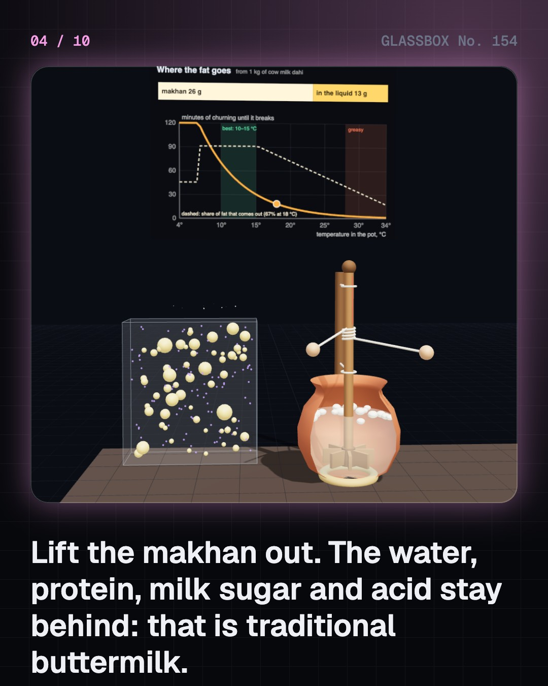

<!-- glassbox:start -->
<!-- Generated from glassbox.json by the Glassbox hub (npm run readme -- buttermilkclear). Edit glassbox.json, not this block. -->
<p align="center"><a href="https://glassbox.how/e/buttermilkclear/"></a></p>

<h1 align="center">ButtermilkClear</h1>

<p align="center"><b>How is buttermilk made?</b><br>Buttermilk has no butter in it. It is what the churn leaves behind once the butter is out, and it is also the name of a drink no churn ever touched. Churn a pot of dahi, watch the curd specks sink in a glass of chaas, pour a tadka, and work out why a cup of it makes a pancake rise.</p>

<p align="center"><a href="https://glassbox.how/buttermilkclear/"><b>▶ Play with it</b></a> &nbsp;·&nbsp; <a href="https://glassbox.how/e/buttermilkclear/">Read the 60-second explainer</a> &nbsp;·&nbsp; <a href="https://glassbox.how/buttermilkclear/glassbox/reel.mp4">Watch the 40-second video</a></p>

<p align="center">
  <a href="https://glassbox.how/e/buttermilkclear/"></a>
  <a href="https://glassbox.how/e/buttermilkclear/"></a>
  <a href="LICENSE"></a>
  <a href="LICENSE-CONTENT.md"></a>
  <a href="#privacy"></a>
</p>

## In 60 seconds

1. **Two drinks, one name.** Traditional buttermilk is the thin, sour liquid left when butter is churned out of dahi or soured cream. Chaas, also called mattha, taak, moru, majjige or ghol, is dahi beaten with water. A dairy's cultured buttermilk is skim milk soured by chosen bacteria. FSSAI groups lassi, chhaach and buttermilk as drinks based on fermented milk, with at least 40% fermented milk.
2. **The churn takes the fat and leaves the rest.** The mathani tears the skins off the fat globules, which stick into grains of makhan. The water, protein, lactose, acid and the torn membrane pieces all stay behind. A clay pot at 18 °C gets about two thirds of the fat out, and less when it is warm, so home buttermilk keeps more fat than a dairy's 0.5%.
3. **Sour, thin, and it settles.** Bacteria turn lactose into lactic acid and the pH falls from about 6.6 to 4.5. Near pH 4.6 the casein links into a gel. Churning breaks the gel into soft specks tens of micrometres wide. They make chaas a few times thicker than water, and by Stokes' law they slowly sink, leaving clear whey on top until you stir.
4. **Water, salt and a tadka.** The recipe is mostly one choice: how much water. A little gives thick lassi, equal parts give chaas, more gives a thin summer drink. Salt, roasted jeera, ginger and curry leaves go in, and a tadka of spices crackled in hot oil carries their aromas, which dissolve in fat. One gram of salt is about a fifth of WHO's daily sodium limit.
5. **The dairy and the oven.** A dairy heats skim milk to about 90 °C, cools it to about 22 °C and sours it for 12 to 16 hours with Lactococcus and aroma-making Leuconostoc. In baking, the lactic acid meets baking soda and makes carbon dioxide: a cup of buttermilk has enough acid for about 1.6 g of soda and gives nearly half a litre of gas.
6. **It keeps souring.** The bacteria are still alive, so chaas left out on a hot day turns sharply sour in hours, while a fridge almost stops them. Sour does not mean unsafe and mild does not mean safe: use boiled or pasteurised milk, clean vessels and safe water, and keep it cold. It replaces water and salt. It is not lactose-free, and it is not medicine.

## Words worth knowing

| Term | Meaning |
|---|---|
| **Traditional buttermilk** | The thin, sour liquid left in the churn after the butter has been taken out. |
| **Chaas** | Dahi beaten with water, salted and often spiced. Called mattha, taak, moru, majjige, majjiga or ghol in other Indian languages. |
| **Cultured buttermilk** | Skim or low-fat milk soured in a dairy by chosen lactic acid bacteria. No butter is made from it. |
| **Phase inversion** | An emulsion turning inside out, as when fat-in-water cream becomes water-in-fat butter and buttermilk runs free. |
| **Isoelectric point** | The pH at which a protein carries no net charge. For casein it is 4.6, and that is where milk sets. |
| **Floc** | A soft speck of broken curd, tens of micrometres across. Flocs make chaas cloudy and slowly sink. |
| **Stokes' law** | The speed of a small ball through a liquid: v = d² Δρ g ÷ 18 η. Twice the diameter means four times the speed. |
| **Tadka** | Spices crackled in hot oil or ghee and poured over a dish. The fat carries their aromas. |
| **Baking soda** | Sodium bicarbonate, a mild base. With an acid such as the lactic acid in buttermilk it gives carbon dioxide gas. |

## A short history

**Eight thousand years from sour milk shaken in a skin bag to spiced chaas in a carton.**

- **200** · Takra gets a recipe (Compilers of the Charaka Samhita and the Sushruta Samhita, India)
- **1780** · The acid in sour milk (Carl Wilhelm Scheele, Köping, Sweden)
- **1846** · Soda meets buttermilk (John Dwight and Austin Church, United States)
- **1879** · The separator ends sour buttermilk (Gustaf de Laval, Stockholm, Sweden)
- **1925** · Buttermilk without butter (Commercial dairies, United States)
- **1970** · Operation Flood (National Dairy Development Board, led by Verghese Kurien, India)
- **2011** · What may be called chaas (Food Safety and Standards Authority of India, New Delhi)

The full story, with 30 moments, charts, people and 47 sources: [glassbox.how/e/buttermilkclear/history](https://glassbox.how/e/buttermilkclear/history/). The data lives in [`history.json`](history.json).

## Video and slides

Made with the Glassbox studio from this box's storyboard (`window.glassbox.director`). Free to reuse under CC BY 4.0.

<a href="https://glassbox.how/buttermilkclear/glassbox/video.mp4"></a>

<p><a href="glassbox/slide-1.jpg"></a> <a href="glassbox/slide-2.jpg"></a> <a href="glassbox/slide-3.jpg"></a> <a href="glassbox/slide-4.jpg"></a></p>

| File | What | Size |
|---|---|---|
| [`glassbox/reel.mp4`](https://glassbox.how/buttermilkclear/glassbox/reel.mp4) | Reel / Short, with captions and soundtrack | 1080×1920 |
| [`glassbox/video.mp4`](https://glassbox.how/buttermilkclear/glassbox/video.mp4) | YouTube video, with captions and soundtrack | 1920×1080 |
| `glassbox/slide-1…10.jpg` | Instagram carousel | 1080×1350 |
| `glassbox/thumb.jpg` | YouTube thumbnail | 1280×720 |
| `glassbox/cover.jpg` | Share card and repo social preview | 1200×630 |
| [`glassbox/history-reel.mp4`](https://glassbox.how/buttermilkclear/glassbox/history-reel.mp4) | “History in 10 moments” Reel / Short | 1080×1920 |
| `glassbox/history-slide-*.jpg` | History carousel | 1080×1350 |
| `glassbox/post.json` | Post copy and schedule used by the publish kit | |

## Privacy

This box has no accounts and no ads, and it ships its own fonts and libraries. When you run it yourself it sends nothing anywhere. On glassbox.how, the site's `/bar.js` also loads Glassbox's analytics: **Google Analytics** to count visits (it asks first in the EU, UK and Switzerland, and stays off when your browser sends Global Privacy Control or Do Not Track) and **ClickTrust** to detect bots.

It remembers a few things **in your own browser only**, and never sends them anywhere:

| Browser storage key | What it holds |
|---|---|
| `buttermilkclear.v1` | Which chapters you have opened, your best quiz scores, and sound on or off. |

Exactly what each one sees is at [glassbox.how/privacy](https://glassbox.how/privacy/).

## Licences

- **Code:** [MIT](LICENSE). Use it, change it, ship it.
- **Explanations, text, images and videos** (`glassbox.json`, `glassbox/`): [CC BY 4.0](LICENSE-CONTENT.md). Credit “Glassbox, glassbox.how/e/buttermilkclear”.
- **Third-party parts** keep their own licences: [three.js](https://threejs.org) (MIT), [Geist, Instrument Serif](https://openfontlicense.org) (SIL OFL 1.1).
- The Glassbox name and logo aren't covered by either licence. See the [terms](https://glassbox.how/terms/).

Found a mistake? [Open an issue](https://github.com/bdeeps/buttermilkclear/issues). Corrections happen in public.
<!-- glassbox:end -->

## Run it

It's plain HTML, CSS and JavaScript. No build step and no dependencies. Run locally, it contacts no other website.

```bash
python3 -m http.server 8000
```

Three.js and the fonts ship in `vendor/` and `fonts/`, so it also works offline.

Then open http://localhost:8000.

## How it's built

| File | What |
|---|---|
| `index.html`, `css/app.css` | The page and its styles |
| `js/app.js`, `js/stage.js`, `js/ui.js`, `js/kit.js` | The shared Glassbox 3D engine: chapters, 3D stage, controls, quiz, video director |
| `js/chapters/*.js` | One file per chapter: the 3D model, controls, text, key terms, quiz and video scenes |
| `js/buttermilk.js` | Shared numbers and models (the churn, souring, Stokes settling, baking soda), chart boards, the matka and mathani, glasses and pots |
| `glassbox.json` | Title, question, explainer beats, key terms, browser storage and credits shown on glassbox.how |
| `reel` in each chapter | The storyboard the Glassbox studio records into short videos |
| `glassbox/` | The published video, slides, thumbnail and post copy |
| `fonts/`, `vendor/three/` | Self-hosted Geist and Instrument Serif (SIL OFL 1.1) and three.js (MIT) |
